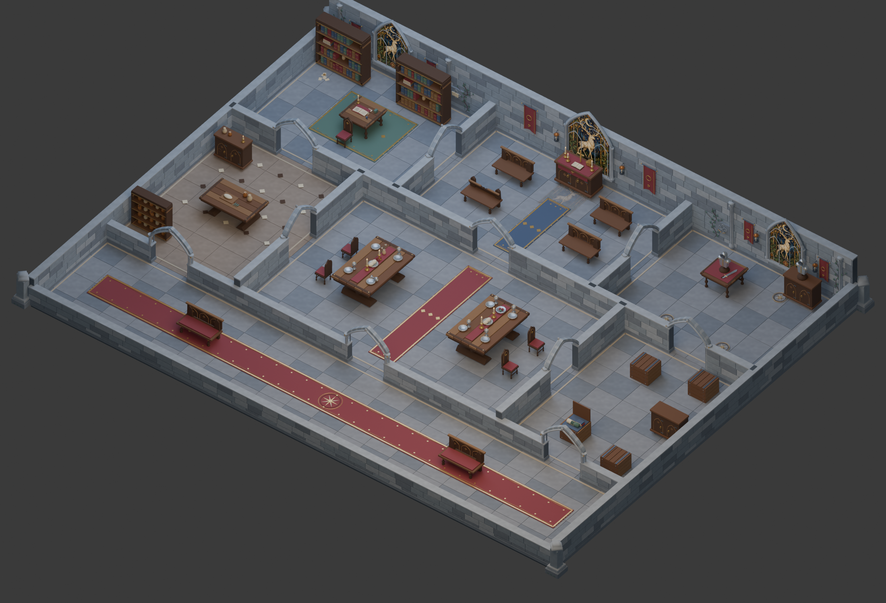
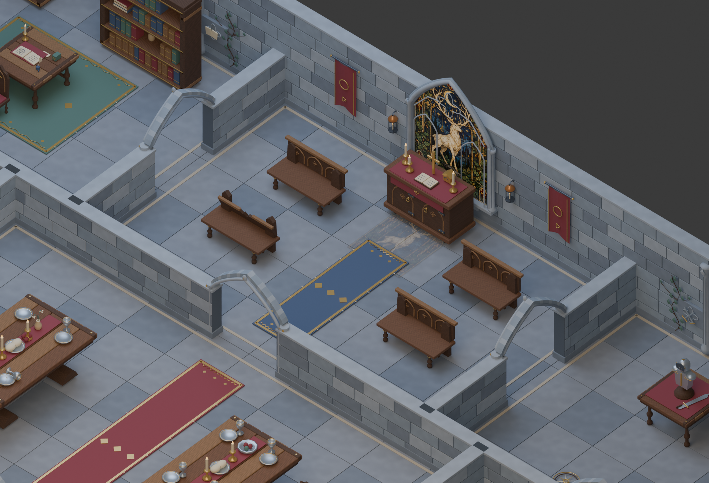
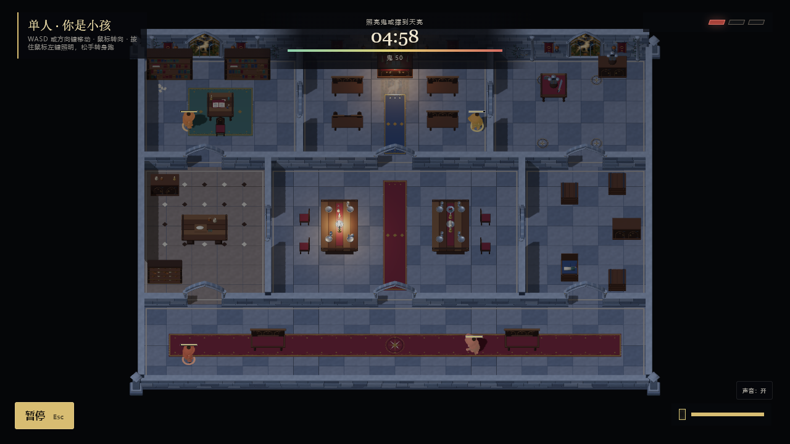
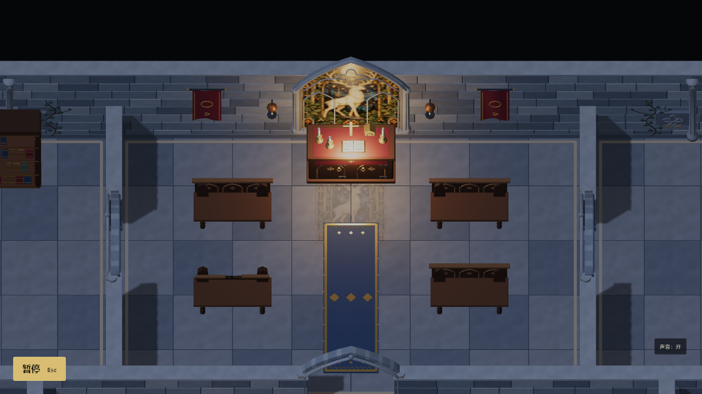
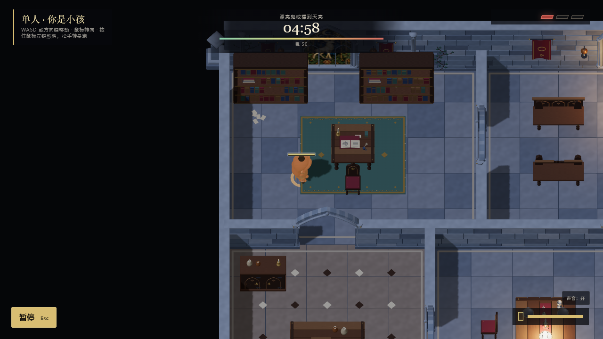
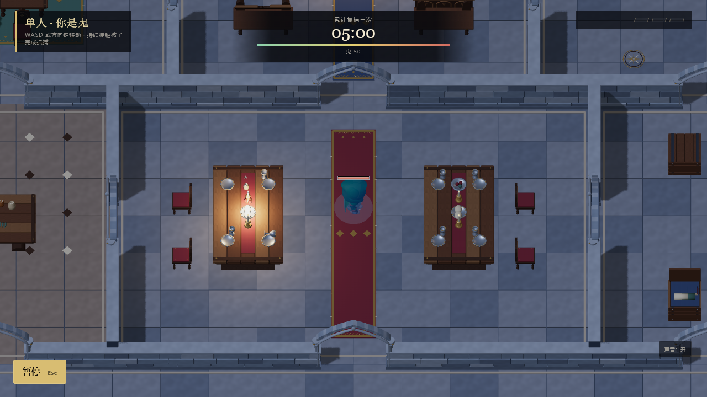
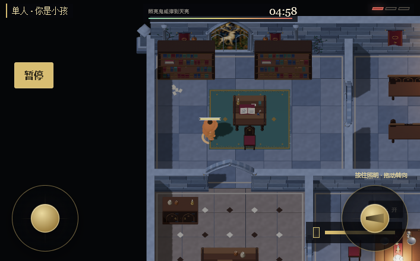

# 古堡精细化制作

## 目标

用户认为第一版古堡不够精致，希望地图值得停下来欣赏。保留七区、双环路、出生点、电池点和家具权威脚印，提升建筑轮廓、表面材质、工艺细节与房间叙事。此项是环境美术改造；角色、捕捉规则、奖励、UI和音效沿用，不能把环境升级等同于整游戏AAA认证。

## 美术与技术方案

主题为被午夜契约遗弃的月纹古堡：石砌基座、层叠哥特拱线、月鹿彩窗、车木与雕花、铜铁五金、旧书卷、未收拾的宴席。精细度优先投入镜头可见的桌面、椅背、拱门、彩窗、地面边饰与墙上陈设。表面有细凿痕、木纹与织物法线，保持低频色块清楚，让追逐时仍辨认角色、门洞和电池。

生成脚本分为几何/摆放入口、家具、建筑陈设和共享表面四部分。Blender源保留编辑分件，GLB按材质合并。家具细节受原27个脚印约束，独立地面装饰保持薄平面；增加的墙上构件不改变路线。高处轮廓集中在北侧背墙，靠镜头侧继续剖切。间接反射服务金属和陶器，礼拜堂与宴会厅新增两处固定、无阴影的暖色烛光；不增加后处理或实时阴影成本。

初始预算：古堡GLB网格≤100，三角形≤250k，文件≤16MB；桌面活跃画面draw calls≤300、三角形≤750k。移动端参考draw calls≤150、三角形≤300k；如果精细环境超出，以真实GPU帧率与可读性核对并如实记录，不自动删除主体工艺细节。先做共享纹理与网格合并；不使用高分辨率逐件贴图或多盏实时灯。

## 素材来源

探测结果：`TRIPO_API_KEY=MISSING`、`GEMINI_API_KEY=MISSING`。外部3D API不可用，家具/建筑为Blender原创；内置ImageGen可用，已实际生成月鹿彩窗画稿，保存为`public/assets/models/midnight-castle/textures/moon-stag-glass.png`。这是真正映射到窗体的表面资源，不是场景截图替代模型。石材、木纹和织物六张512²共享albedo/normal图由固定种子程序生成，原图随源文件保留并嵌入GLB。

ImageGen模式：内置工具，非CLI。最终提示词：

> Use case: stylized-concept. Asset type: production game texture, a SINGLE rectangular portrait stained-glass artwork for an abandoned European Gothic castle chapel. Full-bleed flat orthographic artwork only, no 3D room, no wall, no frame, no mockup, no perspective. An elegant ivory stag with elaborate branching antlers beneath a luminous crescent moon, surrounded by intricate Gothic botanical tracery, night stars, stylized oak leaves and small heraldic quatrefoils. Sumptuous small leaded glass panes, jewel-like midnight blue, faded emerald green, pale amber and muted ruby, thin dark lead outlines with delicate gold ornament. Sophisticated hand-painted fairytale Gothic look, slightly aged glass with mottling, visual hierarchy large stag and moon readable at a distance, fine craftsmanship rewards a close look. Calm mysterious mildly haunted atmosphere suitable for a cute spooky hide-and-seek game. All of the rectangular image filled with the artwork; no external margins, no text or letters, no humans, no logos, no watermark. Portrait composition, 1024 by 1536 if possible. Lighting baked as subtle glass material variation only, no directional shadows. This image will be mapped onto actual arched-window 3D geometry in Blender.

## 基线

`f219747`：40网格、81,524三角形、22材质、零贴图、4,893,736字节。通过正常菜单进入单人游戏，固定随机种子71，桌面1280×720与手机横屏707×440；Intel Arc B390/D3D11，暖机后四个视图均60FPS。全图125 draw calls/173,486三角形，手机81/149,424。全局101纹理是既有引擎分配，古堡自身零贴图。现场截图与完整像素/渲染报告保存于`artifacts/castle-refinement-baseline/`。

## 验证与美术评分

最终成品：49个合并网格、234,916个三角形、25个共享材质、7张嵌入贴图；Meshopt运行版9,484,516字节，未压缩17,249,004字节。源 `.blend`、原始纹理、提示词和生成模块均保留。节点中27个家具代理仍与规则层逐项一致。微小铆钉减少分段，较大的头盔、陶器、椅背和雕饰保持轮廓；重复UV保持浮点，Meshopt仅量化允许的属性。

追加的故事陈设包括折损长凳、祭台手稿与烛台、翻开的旧箱、架中缺失与横放的书、地图蜡封、宴席残留、铜制厨具和兵器陈列。独立复核反馈整图仍显整齐，因此补了这一轮陈设、局部烛光和地面光纹；没有改变权威家具脚印或房间连接。

### Build / QA结果

- `npm run build`通过，保留原有分包体积提示；Meshopt解码器随Three.js代码打包，无外部解码URL。
- `npm run test:rules`185/185通过；古堡5项合同/连通测试包含全部27代理的坐标、朝向和脚印。
- `npm run validate:map -- assets/maps/midnight-castle.scene.json`零问题。
- `npx playwright test tests/castle-map.spec.ts`4/4通过：选择、移动、暂停重开、切回旧图、加载失败回退、加载中销毁、真实触控及材质颜色回归。
- Production preview `http://127.0.0.1:5299/`完成120.9秒实机键盘/鼠标操作，111个样本、5次重开、2次暂停恢复、门洞移动；console/page error为零，结束时仍在对局。
- Visual test harness沿用现有Playwright交互/画布检查；新断言检查wood/wine的实际RGB关系，防止灰度纹理覆盖原色。5个desktop/mobile/inspection截图检查canvas非空，pixel统计采用技能提供的算法。实时AI画面不做固定像素基线，原快照未更新。
- 原图12项旧视觉基线差异此前已用未修改HEAD核对，本次未修改这些快照。没有把专项测试通过写成全套浏览器通过。

### Measured evidence / technical art render budget

固定种子71，Intel Arc B390真实D3D11渲染；desktop1280×720，mobile707×440为同GPU视口模拟。暖机后下列5个状态中位60FPS，无页面或控制台错误。

| 视图 | Draw calls | 三角形 | 几何 | Entropy / edge density / luminance contrast / dominant share |
| --- | ---: | ---: | ---: | --- |
| 小孩 | 93 | 311580 | 171 | 4.12 / .249 / 111.1 / .401 |
| 鬼 | 101 | 317362 | 165 | 4.75 / .331 / 92.6 / .147 |
| 全图 | 136 | 335660 | 172 | 3.72 / .292 / 95.2 / .456 |
| 手机视口 | 90 | 311564 | 171 | 4.35 / .258 / 112.9 / .372 |
| 礼拜堂检查 | 64 | 284736 | 165 | 4.63 / .290 / 102.2 / .186 |

模型三角形/文件/网格在初始预算内；桌面draw calls/三角形在预算内。手机视口三角形比300k参考值高3.9%，当前桌面GPU仍60FPS，不代表真实手机已认证。全局纹理111，基线101；模型7张图，其余包含引擎原有纹理/渲染目标。保持现有DPR、主要阴影和后处理设置；新增烛光不投射阴影。VFX readability沿用原角色/手电/抓捕表现，环境光纹不触发规则照射或揭露鬼。

鬼和礼拜堂检查在正常菜单进入对局后冻结规则更新，继续渲染，以免暖机时AI结束对局；其他截图与生产测试保持实时。前后角色状态不是逐像素一致的性能微基准；不把视觉统计提升等同于艺术质量认证。

### Visual scorecard / fresh-eyes review

建设者完整看过三张校准锚图和全部五个最终状态，再由未读代码与制作背景的独立评审仅根据截图、报告与标准评分。表中采用两者较低分；未呈现的奖励/事件VFX不凭既有代码推定展示质量。此十项表是整游戏证据评估，地图相关四项另列，避免把环境升级误写成整游戏AAA。

| 精确类别 | 建设者 / 独立复核 / 采用 | 证据或范围 |
| --- | --- | --- |
| Art direction | 2 / 2 / 2 | 月鹿、哥特石材、酒红金饰形成一致主题 |
| Hero/player | 2 / 2 / 2 | 沿用原角色，未改造角色表现 |
| Obstacles/enemies | 2 / 1 / 1 | 多种家具可辨认，未展示三种带预告的敌人/障碍行为 |
| Rewards/interactables | 1 / 0 / 0 | 静态地图图不证明奖励收集状态；本次不改奖励 |
| World/environment | 2 / 2 / 2 | 房间陈设与祭台成为焦点，整齐网格/大块行走空间仍限制展陈密度 |
| Materials/textures | 2 / 2 / 2 | 石木织物与细工可见，局部磨损仍克制 |
| Lighting/render | 2 / 2 / 2 | 暖色祭台/宴席衬托冷石，其他房间照明层次较均匀 |
| VFX/motion | 1 / 0 / 0 | 静态截图不证明事件动效；本次沿用 |
| UI/HUD | 1 / 1 / 1 | 既有手机右摇杆与音频/电池区重叠，本次未改UI |
| Performance evidence | 3 / 2 / 2 | 有基线、实测与生产输入验证，真实手机GPU未验证 |

Average采用1.4/3；地图art/world/material/lighting平均2.0/3。Automatic failures：既有手机UI重叠；没有发现环境以默认几何体为主的失败。整游戏premium/showcase门槛未声明通过。这版是已完成并验证的精细化环境制作；最终观感由上述原尺寸画面供用户判断。俯视镜头压缩了墙体/家具纵深，规则网格与安全通道保留；更密集的场景构图需要另行权衡路线与镜头。地面彩窗光纹仍有可辨认的矩形范围。

## 技能、参考与阶段记录

- 已读取director、gameplay-systems、graphics-builder、game-ui-designer、debug-profiler、qa-release、3d-generator、image-generator和imagegen技能。对应技能读取不是API调用。
- 图形参考：模型、架构、渲染、技术美术、shader/material cookbook、十项scorecard，及几何/材质/性能/AAA/技术美术清单。
- QA参考：qa-release-checklists、visual-test-harness及视觉验证/玩家测试/发布/性能清单。
- 已有玩法brief、core loop和level plan见`midnight-castle.md`；本次不改规则、物理或节奏。UI/音频制作不在环境升级范围内；它们的技能已载入，实际改造跳过。
- 3D生成被上述密钥探测阻断；2D用内置ImageGen替代Gemini提供实际输出。建模、材质与QA已完成本轮环境改造，整游戏评级未声明升级。

### Skill-loading ledger / reference ledger / phase ledger

| Phase | 状态与参考 |
| --- | --- |
| Gameplay systems | 技能已读取；gameplay-workflows、game-design-level-design与关卡清单已读取。Game design brief：孩子闯入古堡触发午夜契约，紧张而轻恐怖；core loop为移动/照射/补充资源/追逐与重试。Level/encounter plan沿用七区双环、分散出生、墙角视线与电池风险选择，本轮不改规则。 |
| AAA graphics | 环境阶段完成：模型、架构、渲染、technical-art、shader-cookbook、visual-scorecard与对应清单已读取；Blender源码/GLB/7图/5实机视角为证。整游戏评级未通过或宣称。 |
| UI | 技能已读取，实际重设计跳过，用户范围为地图。 |
| Debug/profile | 技能、debug-profile-checklists和performance-profile清单已读取；完成材质色值、GLB压缩加载、Windows恢复式替换与实测。 |
| QA/release | 技能、qa-release-checklists、visual-test-harness及对应清单已读取；完成规则/浏览器/生产输入、canvas/pixel、完整截图、fresh-eyes review。 |

External asset sourcing / chosen sources：credential probe output为`TRIPO_API_KEY=MISSING`、`GEMINI_API_KEY=MISSING`；3D generator仅完成探测，无付费任务；image generator使用内置ImageGen实际输出。Hero/player沿用；world/sky/background是Blender古堡、无独立天空替换；materials/textures/decals为共享程序PBR图与月鹿画稿；audio沿用现有音效，audio generator不在本轮范围。生成API均未进入浏览器代码。完整来源路径、prompt和输出见上文。

英文索引供报告审计与跨语言检索：

- Core loop: 移动、照射、资源补充、追逐、重试，沿用既有规则。
- Level/encounter plan: 七区双环、门洞选择、墙角视线与分散资源。
- Average: 1.4/3（整游戏静态证据），地图相关四项2.0/3。
- Credential probe output: TRIPO_API_KEY=MISSING; GEMINI_API_KEY=MISSING.
- 3D generator: 密钥阻断，采用Blender原创几何。
- Image generator: 内置ImageGen生成并实际使用月鹿画稿。
- World/sky/background: 古堡建筑与陈设；天空未替换。
- Materials/textures/decals: 七张共享图、原色乘值、纹章与薄层光纹。
- VFX readability: 环境光纹不改变手电命中或鬼显形规则。
- Visual test harness: Playwright交互、载入状态、实际RGB与画布检查。
- Page error: 0; console error: 0.
- Desktop: 1280×720; mobile: 707×440.
- Screenshot: 上述七张耐久PNG包含全部五个实机状态与Blender预览。
