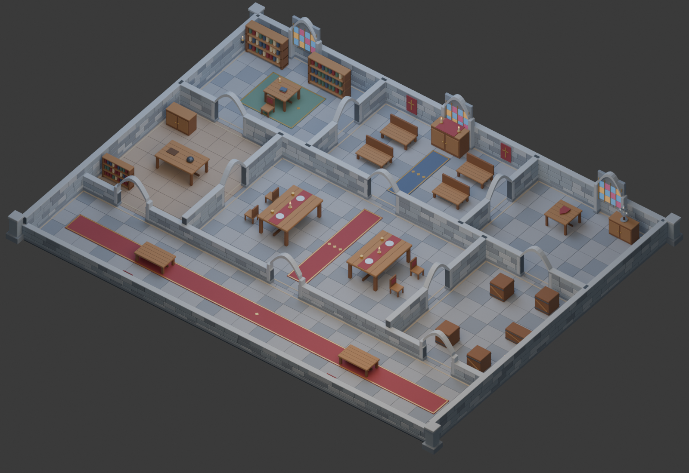
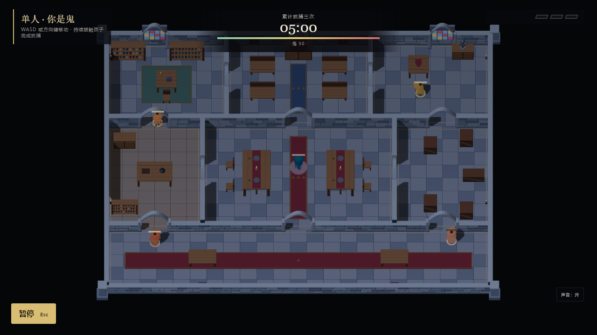
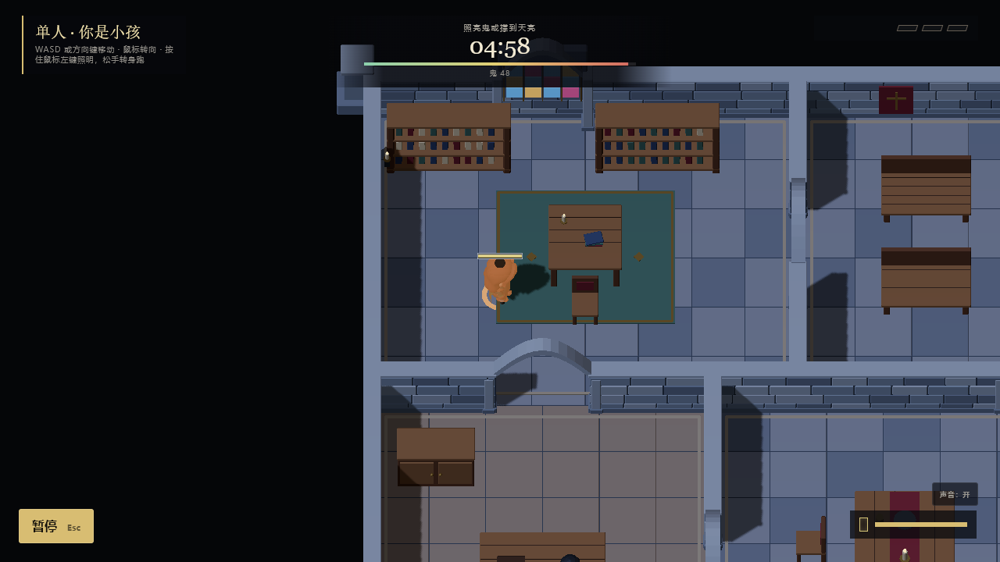
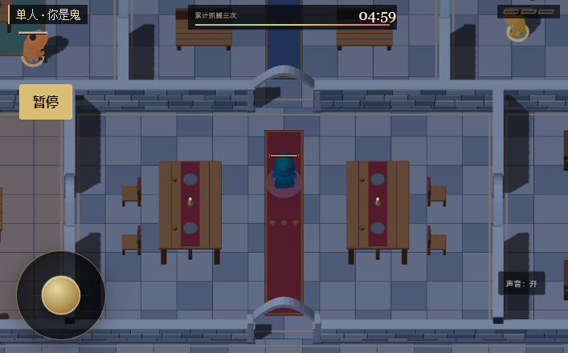

# 午夜契约古堡

## 玩家体验与边界

孩子为证明胆量闯入废弃古堡，触发午夜捉迷藏契约。在冷月光与残留烛火中辨认房间、选择绕行路线、收集电池并用手电应对被附身的伙伴。沿用现有抓捕、reset、感应人偶、胜负与五分钟对局规则；不新增门开关、藏柜或楼层。

核心循环：移动和转角判断 → 选择环路或穿越大厅 → 在追逐压力下补充电池/照射 → 存活或驱散鬼；失败后用现有流程重试。技巧来自记住门洞、利用墙角切断视线、在大厅和侧室之间改变路线。

## 空间计划

32×24 米，单层，无屋顶。北排书房(10×8)、小礼拜堂(12×8)、兵器陈列室(10×8)；中排厨房(8×10)、宴会大厅(16×10)、储藏室(8×10)；南排入口长厅(32×6)。尺寸含墙厚。门洞净宽2.2米，门前保持现有1.25米安全深度。

左右侧室、北排横向门和入口长厅形成绕行回路。四个小孩出生点分散在书房、兵器室和入口两侧；鬼从大厅中央出发。第一选择是绕侧室还是走大厅；书架、礼拜堂长凳与宴会桌提供移动绕行，墙角负责遮挡手电。十个电池候选点覆盖七区。资源消耗与追逐自然形成压力，侧室转角提供恢复机会；不新增时间升级机制。

## 制作合同

- 权威布局：`assets/maps/midnight-castle.scene.json`，同时被客户端、服务器和 Blender 脚本读取。
- 可编辑源：`assets/models/original/midnight-castle.blend`。
- 游戏资源：`public/assets/models/midnight-castle/midnight-castle.glb`。
- 生成：`scripts/blender/build_midnight_castle.py`，Blender 5.2 LTS后台运行，固定随机种子。
- Blender 坐标 `(X, -Z, Y)` 对应游戏 `(X, Y, Z)`，单位米。GLB Y-up，中心在世界原点。
- 灰蓝石材、旧木、褪色酒红挂毯、金属纹章；石砌拱门、彩窗、长桌、书架、厨具和盔甲为原创几何，无外部下载依赖。
- 视觉墙压低：多数1.65米，南侧横墙1.05米；北墙彩窗与门洞拱顶为有限的高处轮廓。碰撞和照射依旧读取二维地图，与视觉高度独立。
- 家具使用现有 catalog ID作为脚印合同，Blender制作对应的古堡外观；GLB `proxy-*` 空节点记录脚印与摆放数据。
- GLB按类别和材质合并，保留`wall-*`、`boundary-*`遮挡层语义；Blender源保留独立可编辑部件。目标场景网格小于100、三角形小于150k、GLB小于8MB；实际渲染成本在浏览器测量。
- 原版地图使用原有管线。古堡加载失败回退到相同规则布局的常规视觉；修改几何的编辑器草稿也使用常规视觉，避免烘焙地图与碰撞不一致。修改后需重新执行Blender脚本才能获得对应古堡网格。

## 复现

```powershell
& 'C:\Program Files\Blender Foundation\Blender 5.2\blender.exe' --factory-startup --background --python-exit-code 1 --python scripts/blender/build_midnight_castle.py -- --render
npm run validate:map -- assets/maps/midnight-castle.scene.json
npm run build
```

`--render`额外生成文档中的斜俯视与俯视PNG；不带参数仍生成 `.blend`、`.glb` 和资源统计。预览使用独立摄影灯，最终可读性以游戏截图为准。

## 技能与来源记录

- 已读取 director、gameplay-systems、graphics-builder、qa-release；玩法/关卡参考、几何/材质/照明/技术美术参考、视觉测试与QA清单用于对应阶段。
- 外部生成：用户指定Blender，使用原创可重复建模脚本。角色、音效和UI沿用现有资源，不触发替换或付费外部生成。
- 玩法阶段：已按既定平面完成地图校验；图形与QA阶段以本文末尾的实测证据为准。UI重设计、物理引擎变更和音效制作不在此次范围内。

## 验收证据

### 成品与视觉检查

Blender 5.2.1 LTS 实际后台生成、保存和渲染。GLB由`@gltf-transform/cli inspect`检查：一个运行时场景，40个合并网格，81,524个三角形，22个共享材质，零贴图、零动画；4,893,736字节。模型包围盒`(-16.825,-0.29,-12.825)`到`(16.825,3.73,12.825)`，包含边界外扶壁；可走范围仍是32×24米。27个空节点用`placementId`记录权威家具身份，避免Blender自动数字后缀改变ID。









已检查石墙、拱门、彩窗、各房间家具、角色落地、可行走门洞和手机HUD。游戏正交跟随镜头保留原设置；全图截图仅用于验收，没有改变玩家默认镜头。矮墙有与规则墙一致的2.8米高隐藏阴影代理，仅被手电/闪电阴影相机读取，防止剖面展示让光穿墙。

### 测试结果

| 检查 | 结果 |
| --- | --- |
| `npm run build` | 通过；保留项目原有大分包提示 |
| `npm run test:rules` | 185/185通过，含5项古堡回归 |
| `npm run validate:map -- assets/maps/midnight-castle.scene.json` | 7房间、16内墙段、27家具/移动碰撞体，零问题 |
| `npx playwright test tests/castle-map.spec.ts` | 4/4通过：选择/移动/暂停重开/切换、404回退、加载中销毁、真实触控事件 |
| GLB合同检查 | 全部27家具代理的世界XYZ、朝向、脚印与规则层一致；每个门洞可通行，堵住任意一个仍有替代路线 |
| 生产预览`http://127.0.0.1:5299/` | 正常界面选择小孩与古堡；持续122秒键盘操作，暂停恢复；GLB HTTP200，无页面/控制台错误，画布亮度跨度227.7 |
| 原地图专项浏览器检查 | 29项中17通过、12旧视觉基线比较失败，未更新旧基线 |
| 原地图平衡模拟 | 16场默认地图模拟，零穿墙/永久重叠/软锁；该工具硬编码默认地图，此结果不代表古堡胜率已调平 |

旧基线差异另用未修改HEAD `c604abd`的独立工作树对照：`child-playing`与`flashlight-wall`在HEAD/本次工作树的1280×720截图逐像素相同（0变化）；它们与已提交基线分别差42,891及42,694像素。说明这两个代表状态的差异已存在于HEAD。全部旧快照均保留，不把专项通过写成全套通过。

### 运行成本与限制

桌面1280×720实测158 draw calls、195,850三角形；手机707×440实测129 draw calls、179,798三角形。几何计数149。两者都在所采用的draw call/三角形起始预算内。全局纹理计数101高于技能的整项目起始预算，古堡模型本身零贴图；本次未做整项目纹理优化或真实手机GPU性能认证。保持现有DPR、灯光与阴影设置，没有新增动态灯或后处理。场景按材质合并；没有为小型室内增加LOD。

回归方式：扩展现有Playwright交互/画布检查，保存桌面、手机、全图与回退截图及诊断JSON于`artifacts/castle-tests/`。实时单人AI由随机种子初始化，截图不作为固定像素基线；确定性几何合同、加载状态和交互断言负责回归。静态文档预览已复制到`docs/images/`，不依赖忽略目录。

### 阶段与参考记录

- 玩法阶段完成：读取`gameplay-workflows.md`、`game-design-level-design.md`与对应关卡清单，产出既定平面与连通回归；不修改物理引擎、规则常量或游戏手感。
- 图形阶段完成：读取`model-recipes.md`、`implementation-blueprint.md`、`render-recipes.md`、`technical-art.md`、`visual-scorecard.md`及几何/材质照明/性能清单；用Blender制作原创几何、共享材质与运行时合并网格。没有提出AAA或整游戏品质升级的验收声明。
- QA阶段完成：读取`qa-release-checklists.md`、visual-verification/playtest-qa/release清单、`visual-test-harness.md`与对应清单；验证新增地图和生产预览，记录旧基线差异与资源预算限制。
- 外部素材阶段跳过：按用户指定的Blender工作流原创建模，没有调用外部3D/图像服务；角色和音效沿用。UI重设计、音频制作、独立物理/性能改造均跳过，范围为新增城堡场景。
